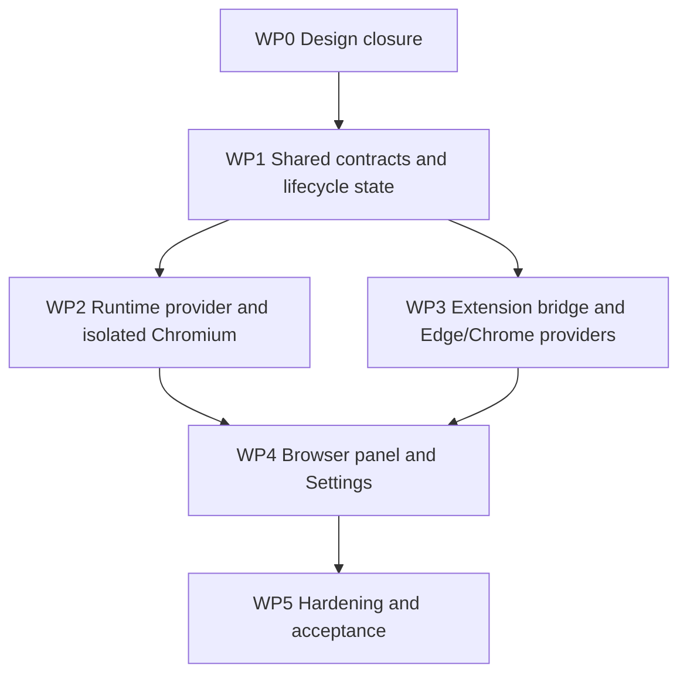

# WebUI Browser Use Development Plan

**Status:** Product and distribution decisions are recorded in ADR 0019; the plan is decomposed into a
published execution board and is ready for `/implement-spec`. No implementation has started.
**Date:** 2026-10-20
**Decision authority:** [ADR 0019](../../packages/webui/docs/adr/0019-webui-browser-use-surfaces-and-external-browser-bridge.md)
**Execution board:** [specification #176](https://github.com/mcode-webui/minimax-code/issues/176) and
tickets #177–#194 on `mcode-webui/minimax-code` — see §10.

This plan turns ADR 0019 into an ordered implementation programme. ADR 0019 is the only place
where Browser Use product decisions and unresolved design questions are recorded. If implementation
evidence requires a decision change, update ADR 0019 first and then revise this plan. This document
does not supersede the ADR.

## 1. Outcome

Deliver WebUI Browser Use with two host-owned browser surfaces:

- An isolated Chromium browser rendered in a WebUI workspace panel, with user input and Agent
  actions operating on the same browser session.
- The user's existing Edge and Chrome browsers, connected through their installed extensions and
  controlled through a loopback WebSocket bridge.

The Agent can choose an authorized external tab per turn. The panel follows the active target. The
browser authorization controls and their lifecycle follow ADR 0019, including its separate Full CDP
access authorization. Disconnection must produce an explicit error after the agreed reconnect
policy; it must not change the selected target or fall back to a different browser surface.

## 2. Scope

### Included

- Runtime-owned provider creation, configuration, readiness and shutdown for isolated Chromium and
  extension-backed Edge/Chrome.
- A versioned, authenticated extension-to-WebUI bridge and per-browser pairing lifecycle.
- Agent browser tool routing and panel rendering/input against the same selected browser target.
- Settings controls, browser/target status, target selection, live page image delivery and basic mouse
  and keyboard input.
- The separate Full CDP access control, with complete provider-supported CDP capability exposure
  only while authorized.
- Automated coverage for contracts, lifecycle, routing, security admission, panel behaviour and
  supported extension packaging, plus real-browser acceptance for Edge and Chrome.

### Excluded

- Silent installation of browser extensions or bypass of browser permission prompts.
- Requiring the user to expose a remote-debugging port or manually provide a CDP endpoint.
- Native Messaging as the extension transport.
- Cross-device or LAN access to the extension bridge.
- Browser automation features that are not already supported by the selected browser-core/runtime
  contract, unless separately approved through ADR 0019.

## 3. Current implementation baseline

These are source observations to guide implementation, not claims that Browser Use is already
available in the WebUI:

- `packages/webui/src/runtime/browser-provider.ts` already defines a host-supplied provider adoption
  seam and forwards the browser adapter/tool exposure into the runtime host.
- `packages/webui/src/runtime/assembly.ts` adopts an optional provider and lifecycle owns its close;
  neither `scripts/run-webui-server.mjs` nor the packaged production entry
  `release/webui-npm/bin/mcode-webui.mjs` supplies one. Both are runtime composition roots and must
  receive the capability consistently; validating only the development entry does not prove the
  shipped WebUI path. Both currently pass `dev: true`, so generic WebUI development-mode admission
  must not be treated as proof that extension pairing credentials are checked.
- The current runtime derives browser-tool availability from provider adoption, while
  `browserToolExposure` describes tool-schema exposure. Neither is, by itself, an independent
  authorization check for the three browser surfaces or the Full CDP capability. Preserve ADR 0019's
  default-off authorizations in the runtime/provider path, even when a provider can be constructed.
- `packages/webui/src/server/access-policy.ts` admits loopback HTTP(S) origins and the WebUI's
  per-start token. It rejects extension origins. `src/server/credentials.ts` creates that token per
  service start, so it cannot meet persistent browser pairing by itself.
- The WebSocket operation path supports cancellable streams. `watchTerminal` and
  `src/server/operation/handlers/terminal.ts` provide a lifecycle pattern for a stream, but image
  frames may require a purpose-built transport shape and back-pressure policy.
- `packages/browser-core` owns provider-neutral browser actions and transport contracts. The WebUI
  must not import `packages/tui`; terminal-client implementations are references only.
- `packages/webui/src/client/features/workspace/ui/WorkspacePanels.tsx` composes workspace panels and
  `WorkspaceHtmlPreview.tsx` previews local HTML in an iframe. That preview is not a browser-control
  surface and must not be repurposed as one.

## 4. Architecture and ownership constraints

Keep the existing four boundaries intact:

1. **Client:** a Browser business owns browser target state, stream subscriptions, user input
   commands and projections. Settings and workspace panels render/use its published contracts; UI
   components do not own browser state or process resources.
2. **Shared:** typed, versioned DTOs define browser status, authorized browser targets, pairing
   state, input commands, stream lifecycle and stable error codes. No Node or browser-specific
   implementation imports enter this layer.
3. **Server:** validates WebUI requests, authorizes them, dispatches browser operations and owns
   extension socket admission and message routing. Keep extension admission separate from the
   generic WebUI page-origin policy; do not allow arbitrary `chrome-extension://` origins.
4. **Runtime:** creates/adopts the browser provider, owns persistent settings/credentials, routes
   browser-core operations, and closes all browser/extension resources through the existing
   lifecycle owner.

Use the existing browser-core transport and runtime adapter seams where their contracts fit. Keep
provider creation outside client code. The extension is a separate execution context and may not
import Node-side WebUI modules. The extension connection must be bound to the relevant browser
identity and tab identity; WebUI client operations must not be able to select arbitrary process
resources by passing an unvalidated provider method name.

The product decisions for extension distribution, pairing credentials, reconnect behavior, per-run
routing, tab presentation and CDP capability limits are recorded in ADR 0019. WP0 verifies the
technical feasibility and pins the implementation contracts without reopening those decisions. If
technical evidence requires a product change, update ADR 0019 before changing implementation scope.

## 5. Work packages

### WP0 — Complete technical validation and contracts

**Purpose:** Validate the accepted product direction against browser APIs and existing runtime seams,
then pin implementable contracts without reopening settled decisions.

**Work:**

- Validate the required Edge/Chrome extension APIs against the minimum supported browser versions,
  including attaching to multiple tabs, the CDP domains/actions required by browser-core, and live
  image capture plus input forwarding. Check the extension debugger API's supported-domain limits
  against the required command set, including download observation and the target/session features
  needed for out-of-process frames.
- Produce a capability matrix for isolated Chromium, Edge and Chrome that identifies the CDP domains
  and commands exposed by each provider, including full-CDP diagnostics and version-dependent gaps.
  Record unsupported commands as unavailable; do not imply that Full CDP removes provider/browser API
  limits.
- Prototype extension-to-loopback WebSocket pairing for each browser, including loopback host/origin
  checks, extension identity, per-browser credential lifecycle, restart and reconnect behaviour. Pin
  the dedicated admission hook in the HTTP upgrade lifecycle and prove pairing credentials are always
  validated, including when the generic WebUI server runs with `dev: true`.
- Verify the operating-system secure credential store path on every supported OS and prove pairing
  fails explicitly if it is unavailable; do not fall back to plaintext credential persistence.
- Verify the extension's required browser permissions and host permissions. Prepare the developer
  unpacked-install path and store-specific build requirements according to ADR 0019; document the
  install/update guidance and missing-permission states.
- Exercise Manifest V3 service-worker termination and restart during an active image stream and an
  in-flight browser operation, not only between operations; record recovery and error behaviour.
- Design the browser/tab identity and target-selection contract so each Agent run/TUN resolves its
  own target while the panel follows the active/focused run. Define per-tab operation serialization
  and stale element-reference handling at target changes.
- Define the bridge protocol versioning, frame/message limits, image delivery/back-pressure,
  cancellation, health/status reporting and explicit error mapping.
- Trace the existing runtime browser-tool authorization and exposure settings. Specify how provider
  construction, each default-off browser authorization, and the separate Full CDP command gate remain
  independent; do not equate provider presence or tool-schema exposure with user authorization.
- Record technical verification results in implementation evidence. If they require a product
  decision change, update ADR 0019 first. Keep this plan as the sequence and acceptance map only.

**Exit criteria:** The protocol and ownership sketch exists; the secure credential-store and
extension-storage path is feasible; the target browser APIs have a synthetic-page feasibility result
and capability matrix; reconnect and concurrent-run contracts are pinned; no generic-origin widening
or implicit target fallback is needed. The product decisions are already recorded in ADR 0019. If a
browser cannot satisfy the accepted contract, stop that browser's implementation and revise ADR 0019
before proceeding.

### WP1 — Define shared contracts and lifecycle state

**Depends on:** WP0.

**Work:**

- Add shared request/response/event DTOs and validators for browser configuration, per-browser
  authorization state, extension pairing/connection status, tab inventory, active target, input,
  image stream and stable failures.
- Create the Browser client business under `packages/webui/src/client/features/browser/`, with only
  the role directories required by its contracts, owners, projections, bindings and UI.
- Create the extension workspace package at `packages/browser-extension/`; include it in this
  repository's public-source projection, register it in `pnpm-workspace.yaml` and
  `release/extraction.json`, then regenerate TypeScript paths and source inventory as required by the
  package guide. Keep extension code outside the WebUI client bundle.
- Define typed provider operations for listing/selecting targets, observing a target, forwarding
  input, and reporting connection/target lifecycle. Match these to browser-core's transport and the
  runtime host's browser adapter/tool exposure types.
- Define target generations so selection changes, tab closure, browser restart and reconnect cannot
  leave Agent element references valid for a different page.
- Define persistence schema and migration behaviour for the three independent authorization states
  and per-browser pairing material, plus the separate Full CDP authorization state, based on WP0's
  ADR decisions. Default newly created state to every authorization off.
- Define a two-mode CDP capability gate: normal browser operations use the restricted command set;
  Full CDP mode exposes all commands the selected provider/browser supports. Keep the gate in the
  runtime/provider path so client requests cannot bypass it.
- Register new test files in `test/vitest-suites.json` as part of their addition.
- Give the extension package its own typecheck command and register that command in
  `scripts/verify.mjs`; the existing WebUI typecheck programs do not cover `packages/browser-extension/`.

**Exit criteria:** Types prevent cross-browser credential/target confusion; invalid/stale target
commands fail with stable errors; client and server type-check from the same shared contract; schema
default and migration behaviour are pinned by unit tests; Full CDP authorization is separately
represented and cannot be inferred from an Edge/Chrome/isolated-browser switch; extension source is
included in the right verification gate and public-source inventory.

### WP2 — Implement runtime browser provider and isolated Chromium

**Depends on:** WP1.

**Work:**

- Implement the host-owned provider for the isolated Chromium surface using the selected browser-core
  adapter contract and a dedicated temporary profile with deterministic cleanup.
- Gate full diagnostic CDP domains behind the separate Full CDP authorization while keeping the
  ordinary browser action set available when that authorization is off.
- Supply the provider consistently from both WebUI service composition roots when the
  isolated-browser setting is enabled: `scripts/run-webui-server.mjs` for the development path and
  `release/webui-npm/bin/mcode-webui.mjs` for the packaged production path. Preserve the existing
  optional-capability behaviour when disabled. Provider construction alone must not grant browser
  authorization or Full CDP access.
- Bind browser tool exposure to the provider's current target/session and prevent stale references
  after session changes.
- Add lifecycle cleanup for Chromium processes, profile directories, stream pumps and pending input;
  cover partial startup failure and idempotent shutdown.
- Keep the existing provider-derived browser-tool availability and tool-schema exposure semantics
  from bypassing the persisted browser authorization and Full CDP command gate.
- Add a settings path for enabling/disabling the isolated browser, with default-off behavior and
  observable readiness/failure state.

**Exit criteria:** With the setting off, no Chromium process starts and Agent browser operations are
unavailable on that surface.
With it on, a synthetic page opens in the isolated profile, Agent operations and panel input affect
the same page, and service close/boot failure releases all owned resources. The real provider path is
exercised; a fake provider alone is insufficient for this exit.

### WP3 — Implement extension bridge and external browser providers

**Depends on:** WP1; may proceed alongside WP2 after shared contracts stabilize.

**Work:**

- Build `packages/browser-extension/` for Edge and Chrome. Implement the extension service worker,
  pairing lifecycle, tab inventory, active-tab
  attachment, CDP command routing, screenshot/image delivery, user-input delivery and reconnect.
- Route only the restricted command set while Full CDP authorization is off; when it is on, expose
  every CDP command supported by that browser/provider and report unsupported methods faithfully.
- Add a dedicated loopback WebSocket endpoint/admission path for extensions. Validate loopback Host,
  exact supported extension identity, pairing credential, protocol version, message sizes and
  per-browser switch state. Perform these checks in the dedicated upgrade admission path before the
  generic WebSocket handler; pairing authentication must remain enforced when `dev: true` disables
  generic WebUI credential checks. Keep the existing page WebSocket origin policy unchanged.
- Persist separate Edge and Chrome authorization state and pairing credentials using WP0's chosen
  OS secure credential store and extension local storage as defined in ADR 0019. Use
  challenge-response pairing. Turning off a browser switch must revoke active sockets, reject old
  credentials and prevent reconnect; turning it back on must establish a fresh pairing. Fail
  explicitly if the OS secure credential store is unavailable.
- Route browser-core provider operations through the matching extension connection and
  run/TUN-scoped target. Preserve independent Edge and Chrome availability and report an explicit
  unavailable state when a browser or extension is absent.
- Implement ADR 0019's bounded operation reconnect and continuing background retry policy. While an
  operation is retrying, retain its exact browser/tab target; after the deadline, return the explicit
  error without replaying an operation whose result is uncertain or switching targets.
- Show accessible tabs with browser, title, URL, connection status and active Agent-run indicator.
  Report browser/API policy-blocked targets as unavailable; do not add a per-tab permission prompt.
- Verify extension worker termination/restart while image frames are flowing and while a browser
  operation is in flight. Confirm reconnection resumes only the same authorized browser/target, or
  returns the specified explicit failure.
- Provide Settings guidance for installation, missing permissions, unavailable extension and
  pairing/connection state without treating extension presence as authorization.

**Exit criteria:** Synthetic integration tests cover successful pairing, restart persistence,
credential rotation/revocation, extension restart, reconnect, expired credentials, wrong extension
identity, disabled-switch rejection, independent concurrent run targets, same-tab operation
serialization, tab selection and target loss. Real installed extension acceptance passes separately
in Edge and Chrome.

### WP4 — Build the Browser workspace panel and Settings controls

**Depends on:** WP1, WP2; WP3 for external browser targets.

**Work:**

- Implement the Browser client business in `packages/webui/src/client/features/browser/` with
  application-owned state, generation/freshness checks, transport bindings and projections for
  browser status, targets, selected target, image stream and failures.
- Add a workspace Browser panel that consumes the live image stream and forwards pointer, keyboard
  and text input through validated commands. It must not iframe the target origin.
- Keep target identity scoped to the Agent run/TUN. When the active run chooses a different authorized
  tab, update the panel to that run's target and invalidate old page-element references before
  subsequent actions; do not overwrite another run's target selection.
- Add four independent Settings controls: isolated browser, Edge, Chrome and Full CDP access. All
  authorization controls default off. The Full CDP control describes its broader diagnostic/internal
  access and grants that capability while enabled. Settings components call the Browser owner
  through its public contract rather than owning browser state.
- Handle loading, disabled, no-browser, no-tabs, pairing, reconnecting, target-closed, stream-failed
  and permission-required states with explicit user-readable outcomes.
- Apply existing WebUI design tokens and keyboard/focus conventions.

**Exit criteria:** Built WebUI demonstrates two-way control on a synthetic page; the displayed page
is the same page targeted by Agent tool operations; switching tabs updates the panel and stale refs
cannot act on the previous page; browser authorization and Full CDP authorization are separately
visible and controllable; toggling Full CDP changes access to provider-supported diagnostic commands
without disabling ordinary browser actions.

### WP5 — Harden boundaries and complete acceptance

**Depends on:** WP2, WP3, WP4.

**Work:**

- Security review pairing, credential storage, extension admission, all-tab authority, input routing,
  stream limits, cancellation, logging and error paths against ADR 0019 and the WP0 protocol.
- Add adversarial tests for origin spoofing, non-loopback hosts, wrong browser identity, old pairing
  credentials, oversized/malformed frames, duplicate extension connections, stale target generations,
  unauthorized operations, Full CDP disabled/enabled command gates, and revocation during an
  in-flight action. Include proof that extension pairing credentials are rejected/accepted correctly
  with `dev: true`, and that unsupported provider commands fail as unsupported rather than silently
  falling back.
- Run the actual built-client scenario through `release/webui-npm/bin/mcode-webui.mjs` with the
  production WebUI runtime and installed extensions; keep synthetic/mock integration evidence
  separate from real browser evidence. Also verify the development entry without treating it as a
  substitute for packaged-entry acceptance.
- Update the source-owned architecture/runtime/client docs for implemented behaviour only after
  source and tests establish it. ADR 0019 remains the only Browser Use decision record.
- Review the new package/file list, workspace membership, release inventory and standalone bundle
  boundaries. Prepare separate Chrome Web Store and Edge Add-ons artifacts from the shared extension
  source and validate each store identity. Prepare accurate single-purpose, permission, data-use and
  privacy disclosures for each store. Store submission and publication remain a separate release
  action from local implementation acceptance.

**Exit criteria:** Required repository gates pass, the release/source inventory contains only
reviewed files, and the acceptance matrix below has recorded results for isolated Chromium, Edge and
Chrome. Any unavailable platform/browser is called out explicitly rather than inferred from another
platform's result.

## 6. Acceptance matrix

| Surface | Required acceptance |
| --- | --- |
| Isolated Chromium | Default off; dedicated temporary profile; enable/disable lifecycle; visible stream; user pointer/keyboard input; Agent action on same page; cleanup on normal and failed startup. |
| Edge extension | Developer unpacked install and store-distribution build; permission flow; switch default off; switch enables pairing and all accessible-tab authority; per-run target selection; panel follows active run; restart reconnect; off revokes credential/socket; bounded operation retry reports error without replay or fallback. |
| Chrome extension | Same behaviours as Edge, verified against supported Chrome versions, Chrome Web Store build and MV3 worker lifecycle. |
| Full CDP access | Default off; browser switches alone do not enable it; enabled switch exposes all capabilities supported by the active provider; disabled switch rejects full-CDP-only commands while ordinary browser operations continue. |
| Shared target | Each Agent run/TUN retains its own browser/tab/generation; panel follows the active run; same-tab operations serialize, different tabs may proceed independently; changing target invalidates old references before another action. |
| Security | Existing generic WebUI Origin policy remains narrow; extension endpoint requires its dedicated identity and credential checks; disabled or revoked browser cannot issue commands; loopback only. |
| Failure handling | Browser/extension/tab closure, malformed bridge traffic, stream cancellation, unavailable secure storage and partial startup each produce stable errors and deterministic cleanup; uncertain operations are not silently replayed. |

## 7. Verification plan

Verification is selected by changed surface; exact commands follow the current package guide and
`packages/webui/docs/verification/gates.md` when implementation begins.

- Shared contracts or WebUI TypeScript: `pnpm typecheck:webui` and focused unit coverage. The
  extension package must also run its dedicated typecheck command registered in `scripts/verify.mjs`;
  `pnpm typecheck:webui` does not cover it.
- Client state, Settings or panel behaviour: focused WebUI unit suite, `pnpm test:webui`, then
  `pnpm build:webui` and `pnpm test:webui-browser` for built-client behaviour.
- Server admission, bridge protocol or runtime operations: focused unit tests plus a loopback
  integration test exercising the production service and runtime boundary.
- Dependency or role changes: `pnpm check:webui-dependency`.
- Packaging/build graph: `pnpm build:webui`, `pnpm check:webui-boundary`, and
  `pnpm test:webui-package` where the shipped artifact changes.
- File additions/moves/package roots: review the diff, regenerate the source inventory, then run
  `pnpm check:source`; regenerate TypeScript paths if workspace package exports require it.
- Before delivery: run applicable gates from `pnpm verify` once for the final inputs, reusing prior
  gate evidence only when its source/config/platform inputs are unchanged.
- Manual acceptance: run the built WebUI with a real installed Edge extension and a real installed
  Chrome extension independently. Synthetic pages should contain no account data. Record browser
  version, OS, enabled settings and observed result.

Mocks and synthetic extension peers prove protocol and routing behaviour only. They do not prove
browser permission prompts, extension installation, real CDP command support, MV3 worker lifetime,
or end-to-end control of an authenticated browser.

## 8. Delivery order and dependencies

WP2 and WP3 can run in parallel after WP1 contracts are stable. WP4 can start its static panel and
Settings scaffolding during WP2/WP3, but must not claim end-to-end acceptance until both providers
and the shared target-routing contract are integrated.

## 9. Completion definition

The work is complete when the acceptance matrix passes for isolated Chromium, Edge and Chrome on the
supported environments; the Settings state, pairing/revocation lifecycle and same-target guarantee
are exercised through the real application path; all relevant repository gates pass; source/package
inventory changes have been reviewed; and implementation documentation reflects verified behaviour.
The decision log remains ADR 0019, with no duplicate Browser Use decisions or unresolved questions in
other documents.

## 10. Execution board and handoff

The plan is decomposed into an executable ticket board on the repository's issue tracker
(`mcode-webui/minimax-code`, the `origin` remote of this checkout). The parent specification is
[#176](https://github.com/mcode-webui/minimax-code/issues/176); the tickets are #177–#194, each
labelled `browser-use` and `ready-for-agent`, each citing ADR 0019 and this plan as its authority,
and each declaring its blocking edges as native GitHub issue dependencies.

| Ticket | Work packages | Title | Blocked by |
| --- | --- | --- | --- |
| #177 | WP0 | Validate the technical contracts and pin the capability matrix | — |
| #178 | WP1 | Four independent browser authorization switches, default off | #177 |
| #179 | WP2 | Isolated Chromium provider starts under authorization | #177, #178 |
| #180 | WP4 | Browser panel shows the isolated Chromium's live page | #179 |
| #181 | WP4 | User pointer and keyboard input reach the same isolated page | #180 |
| #182 | WP2, WP4 | Agent browser operations act on the page the panel shows | #179, #180 |
| #183 | WP0, WP1 | Target generations invalidate stale element references | #182 |
| #184 | WP1, WP2 | Full CDP access is a separate gate in the runtime/provider path | #179 |
| #185 | WP1, WP3 | Extension package, dedicated loopback admission and pairing | #177, #178 |
| #186 | WP3, WP4 | External browser tabs become targets the panel follows | #180, #185 |
| #187 | WP0, WP3 | Live page images from the external browser reach the panel | #186 |
| #188 | WP3, WP4 | User input reaches the external browser tab | #186 |
| #189 | WP3 | Agent operations run against an external tab through the bridge | #185, #186 |
| #190 | WP0, WP3 | Per-browser pairing credential lifecycle | #185 |
| #191 | WP0, WP3 | Bounded reconnect during an operation, background reconnect while enabled | #190 |
| #192 | WP0, WP3 | Extension worker termination and restart recover the bridge | #187, #191 |
| #193 | WP3, WP5 | Edge and Chrome parity, store builds and real-browser acceptance | #188, #189, #192 |
| #194 | WP5 | Security hardening, adversarial coverage, packaging review and documentation | #193 |

The work packages are horizontal by design; the tickets are vertical. A ticket that names two work
packages is one that cuts across both, and the column says which parts of each it carries.

### How to run the board

- **#177 is the first ticket and it blocks every other ticket.** The capability matrix, the bridge
  protocol, the credential-store feasibility, the worker-lifecycle behaviour and the reconnect
  contract are what the later tickets are written against. Until it lands, their technical detail is
  provisional.
- **The authority is ADR 0019, and it is in git.** An implementer reads the ADR and the ticket body.
  This plan, the exploration notes and the board drafts are workspace material: `.plan/` is
  git-ignored and excluded from the published source projection, so they are not present in a git
  worktree. Nothing an implementer needs may live only here.
- **The research notes are published as tracker issues** so a worktree-based implementer can reach
  them: #173 (runtime and server seams), #174 (browser-core contracts and client conventions),
  #175 (repository plumbing for a new package and gates).
- **Branches.** The integration branch is created from an explicit ref on the fork's `webui`
  branch, not from wherever `HEAD` happens to be. Per-ticket branches follow the fork workflow
  (`feat/<short-description>`), and their pull requests target `webui` on the fork. Nothing is ever
  pushed to upstream.
- **Gates.** Each ticket names the gates that bear on it. `pnpm verify` is the delivery gate.
  `pnpm typecheck:webui` does not cover the extension package, which carries its own typecheck
  command registered in `scripts/verify.mjs`.
- **Closing.** A ticket is resolved by closing it; the parent specification #176 is closed when the
  board is complete.
- **A change of direction is an ADR change first.** If implementation evidence contradicts ADR 0019,
  ADR 0019 is amended before the affected ticket's scope changes.
