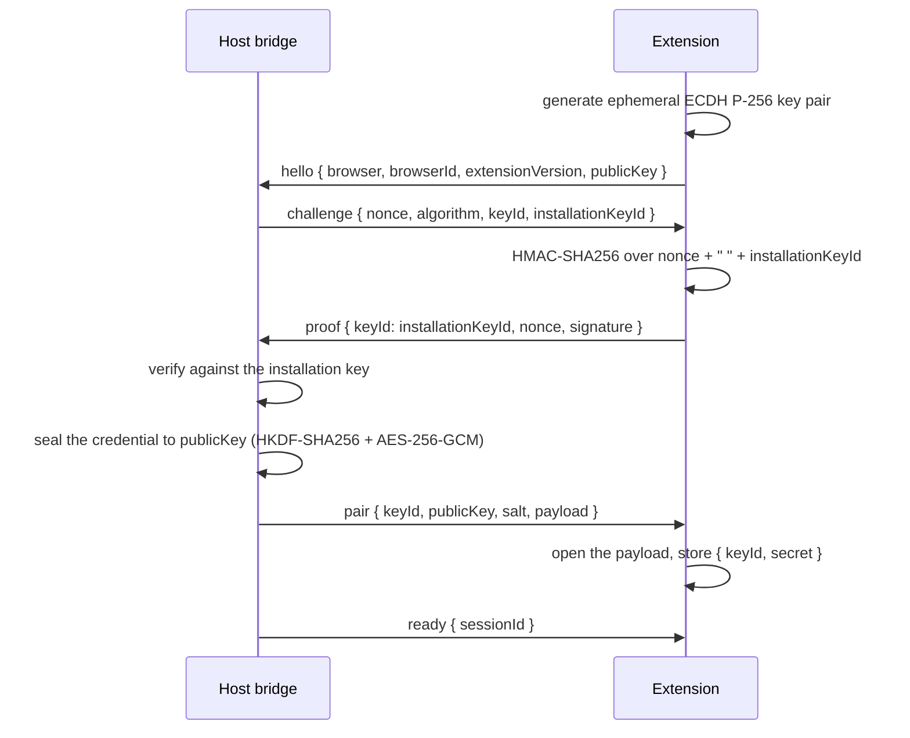

# The extension bridge protocol

**Status:** This document mixes three kinds of statement, labelled inline:

| Label | Means | Backed by |
| --- | --- | --- |
| `implemented` | The source does this today; the row names the file and line. | `packages/webui/src/shared/contracts/browser-bridge.ts`, `packages/webui/src/server/browser-bridge/`, `packages/browser-extension/src/` |
| `required` | A rule the contracts pin with no enforcing code at that point. | The contracts |
| `not yet measured` | An open question. Not a denial and not a promise. | Nothing |

**The protocol is implemented on both sides and wired end to end.** Both the host contract and the
extension carry the frames, the credential transfer, the challenge/proof and the reconnect ladder. The
server's upgrade dispatcher branches on `/browser-bridge` before the generic admission, and a bridge
command is routed to the session that **owns** the target rather than to the most recently admitted one.

**It has been exercised in real browsers.** The handshake completes and an unprovisioned peer is
refused, each on its own surface: the `chrome` surface in Chrome and the `edge` surface in Edge. See
[`07-review-findings.md`](07-review-findings.md) and
`packages/webui/test/browser/browser-bridge-real-browser.spec.ts`.

The bridge is the only way this process reaches the person's own browser. It is a WebSocket on
loopback, but it is **not** the WebUI's own WebSocket: it has its own path, its own admission and its
own credential, because what connects to it is a browser extension rather than the WebUI page.

## Path

`WEBUI_BROWSER_BRIDGE_PATH` is `/browser-bridge` — a dedicated path, not an addition to the WebUI's
own path. Admission on this path is described in
[`03-extension-admission.md`](03-extension-admission.md).

## Frames

The two directions are separate types. The host is the only side that issues a challenge; the
extension is the only side that answers one.

### Client → host (`WebuiBrowserBridgeClientFrame`)

| `kind` | Carries |
| --- | --- |
| `hello` | `browser` (`edge` or `chrome`), `browserId`, `extensionVersion`, and the per-connection `publicKey` |
| `proof` | `keyId`, echoed `nonce`, base64 `signature` — the answer to the outstanding challenge |
| `targets` | The targets the extension can reach, each with `browserId`, `targetId`, `title`, `url`, `generation` |
| `frame` | One `WebuiBrowserBridgeImageFrame`: `browserId`, `targetId`, `generation`, base64 `data`, `format`, `sequence` |
| `input-result` | `commandId`, `accepted`, optional `error` |
| `pong` | The `nonce` answering a `ping` |

### Host → client (`WebuiBrowserBridgeHostFrame`)

| `kind` | Carries |
| --- | --- |
| `pair` | `keyId`, `publicKey`, base64 `salt`, base64 `payload` — the host's credential, encrypted. Sent **only** after an installation-key proof. |
| `challenge` | `nonce`, `algorithm`, `keyId` (the pairing credential), `installationKeyId` (the anchor a first pairing proves) |
| `ready` | `sessionId` — the bridge session is admitted |
| `input` | `commandId` and a `WebuiBrowserBridgeInputCommand` |
| `ping` | `nonce` — the liveness check. The host sends one every ten seconds once the session is admitted, and closes the session when the pong does not come: a socket can look open long after the browser behind it is gone, and the extension's reconnect ladder is what picks the session back up |
| `closed` | `reason` |

### The exact wire shapes of the exchange

`publicKey` on `hello` is the extension's per-connection ECDH public key:

```ts
{ kty: "EC", crv: "P-256", x: string, y: string }   // base64url, unpadded
```

`pair` carries the host's own ephemeral public key alongside the cipher, because
both halves of the ECDH shared secret depend on it:

```ts
interface WebuiBrowserBridgePair {
  kind: "pair";
  keyId: string;                                        // not secret; the challenge names it
  publicKey: { kty: "EC"; crv: "P-256"; x: string; y: string };
  salt: string;                                         // base64 of 16 HKDF salt bytes
  payload: string;                                      // base64( iv || aes-gcm-ciphertext )
}
```

Every target-bearing message on the bridge carries a `generation`
(`WebuiBrowserBridgeTarget`, `WebuiBrowserBridgeImageFrame`, and each `WebuiBrowserBridgeInputCommand`
variant). The bridge is the edge where the `WebuiBrowserTargetId` contract
(`packages/webui/src/shared/contracts/browser.ts`) is projected down to the three fields the extension
can actually resolve; see [`05-target-identity.md`](05-target-identity.md).

### How a command is routed — `implemented`

`BrowserBridgeRegistry.dispatch` (`packages/webui/src/server/browser-bridge/registry.ts`) is the
host's outbound command path. It serializes per target: commands for the same target queue behind each
other, and different targets proceed in parallel.

It routes through a **target-ownership table** rather than guessing. Each session's `targets` frame
records which session owns which `browserId`/`targetId`, and at which generation
(`targetOwners`, `registry.ts:166` and `registry.ts:243`). A command is then resolved against that
table and refused — never guessed — in three distinct ways:

| Condition | Refusal |
| --- | --- |
| No session announced that target | `no bridge session announced target "…"` |
| The announced generation is behind the command's | `target "…" moved on: command generation N, announced generation M` |
| The owning session has gone | refused rather than delivered to a stale socket |

Ownership is dropped when a session ends (`registry.ts:256`). Finding F4 in
[`07-review-findings.md`](07-review-findings.md) records what this replaced: routing to the most
recently admitted session, which could deliver a command to the wrong browser.

### The extension's image path is not CDP

A bridge `frame` is not a screencast. `packages/browser-extension/src/images.ts` documents that
`chrome.debugger` exposes a restricted CDP subset that **excludes** `Page.captureScreenshot`, so an
attached debugger cannot produce an image frame at all; the extension captures through
`chrome.tabs.captureVisibleTab` instead. Two consequences follow, and neither is measured here:

- Only the tab the person is currently looking at, in a window that is in front, can be captured. A
  background tab yields no frame, and the extension reports that rather than substituting another tab.
- The renderer-attachment retry described in
  [`01-capability-matrix.md`](01-capability-matrix.md) applies to the isolated provider only. It has no
  analogue on this path.

**The bridge's `screenshot` action is answered from that same source.** The extension is already
streaming pictures of the tab in front, and a picture of that tab is exactly a screenshot of the
page — so the bridge's core session takes its pictures there rather than from a DevTools command,
through the core's `captureScreenshot` hook. A tab that is **not** in front therefore has no picture
to give, and its screenshot is refused with `browser_capability_denied` rather than answered with
somebody else's page. This is the boundary `Page.captureScreenshot` would have crossed: a DevTools
screenshot can capture any tab on demand, including the ones the person is not looking at.

See [`10-browser-core-integration.md`](10-browser-core-integration.md).

## Pairing: proof first, credential second

The credential is **host-authored**. The extension does not mint one: two
independently minted credentials never match, and the host would reject a proof
made with the wrong one. Instead the host delivers its credential, encrypted to
a key the extension mints for that one connection — but only once the peer has
proved it is a real extension.

Pairing is challenge-response rather than a shared bearer token, so a proof
lifted off the loopback socket is useless against the next connection, and a
captured proof is useless because it is bound to a fresh nonce.

**Proof first, credential second.** A peer that has proved possession of the
**installation key** — the long-lived secret the person pasted into the
extension's options page, and the one secret a local process cannot reach — is
entitled to the pairing credential. A peer that proves only a pairing credential
this host already issued is already paired and receives nothing further. A peer
that proves neither is refused and **no `pair` frame is sent at all**.



The challenge names **two** key ids: `installationKeyId`, which a peer proves to
be entitled to a credential, and `keyId`, the current pairing credential an
already-paired peer answers with. The key id in the proof selects which branch
the host takes, so a proof made for one anchor cannot be replayed as the other —
the key id is inside the signed material.

A peer that already holds the pairing credential answers with `keyId` and is
admitted with **no `pair` frame**. Re-sealing a credential it already holds
would put the credential on the wire again for no gain, and would blur the one
property worth being able to check by reading one line: a `pair` frame is sent
only after an installation-key proof.

The person has to paste the installation key once per browser — see
[`04-pairing-credentials.md`](04-pairing-credentials.md). Provisioning is explicit
because an unprovable peer identity cannot be automated away: the ADR's
"automatic pairing" is about not asking about **tabs**, and it does not survive a
peer that cannot be told apart from a local process.

### The cipher — `implemented`

| Step | Value | Pinned as |
| --- | --- | --- |
| Agreement | ECDH, `P-256`, ephemeral on both sides | `generateWebuiBrowserBridgeEcdhKeyPair` |
| Key derivation | HKDF-SHA256 → 256-bit AES key | `WEBUI_BROWSER_BRIDGE_PAIR_HKDF_INFO` |
| HKDF `info` | `"webui-browser-bridge-pair-v1"`, ASCII, identical on both sides | `WEBUI_BROWSER_BRIDGE_PAIR_HKDF_INFO` |
| HKDF salt | 16 random bytes from the host, sent in the clear | `WEBUI_BROWSER_BRIDGE_PAIR_HKDF_SALT_BYTES` |
| Encryption | AES-256-GCM, 12 random bytes of IV | `WEBUI_BROWSER_BRIDGE_PAIR_AES_IV_BYTES` |
| Plaintext | `base64(secretBytes)` — one self-contained string | — |
| Payload | `base64( iv ‖ ciphertext )`; the ciphertext already carries its 16-byte GCM tag | — |

The only bytes that cross the wire are the two public keys, the salt and the
encrypted payload. The `pair` frame carries the credential's **key id** in the
clear, which is not secret and which the challenge needs.

A mismatch in the `info`, the curve, the salt width or the plaintext encoding is
a protocol break, not something to fall back from — the shared vector below is
what catches it.

### Pinned cross-implementation vector for the transfer

Both packages assert this exact payload. The host computes it in
`packages/webui/test/unit/browser-bridge-pairing.test.ts`; the extension opens
it in `packages/browser-extension/test/protocol.test.ts`. A change to the
construction on either side breaks exactly one suite.

| Input | Value |
| --- | --- |
| Host private key, P-256 JWK | `x` `XKwRVe-iSDOdOSBcT7wi5-6UDoXhSi_sJIva2FRwf-A`, `y` `JOmNw0lXPLULOJ02rq1ElmxknaPEkcoSGN7aHuVzYZk`, `d` `JGSt5D3d1wIlUCrVHgcNvnsFK8uMWG_YUCcHFsySgd0` |
| Extension private key, P-256 JWK | `x` `E97C62Slhb6xSK8jBY_vKNp_bXdZdUyq2z16I_ozyCA`, `y` `-h7QnrdbdOmS5Wgxe8VSGJWBLpsptMBSCKmLKYcockY`, `d` `1xQC1vkpguxZrUo9vhBkgX76gSaP3yiIv7YjgJUa4CA` |
| Salt, base64 | `AAECAwQFBgcICQoLDA0ODw==` (bytes `00 01 … 0f`) |
| IV, base64 | `EBESExQVFhcYGRob` (bytes `10 11 … 1b`) |
| Plaintext (`base64(secret)`) | `ABEiM0RVZneImaq7zN3u/w==` |
| Secret, hex | `00112233445566778899aabbccddeeff` |
| **Expected payload, base64** | `EBESExQVFhcYGRobrpzg8LW2dZC7oVrnYW8vU8zfjg8p/FNAc/YdMgkvUx7+O5ceWIULAw==` |

These are published test constants, not credentials.

### Backward compatibility is explicit

| Case | Behaviour |
| --- | --- |
| A `challenge` with no `installationKeyId` | The extension refuses the frame and closes the socket. Without it the extension cannot tell which key the host will accept a proof with, and answering with the pairing credential on a first connection would fail against a host that has none. |
| `hello` with no `publicKey`, but a valid installation-key proof | Refused with `no_peer_public_key`. There is nothing to seal the credential to, and admitting an incomplete handshake would be a lie. |
| A `publicKey` that is not a P-256 JWK | Refused by a structural check before any sealing, so no `pair`. |
| The surface's switch is off | The host holds no credential and issues no challenge; the existing admission already refuses the connection. |
| The host sends no `pair` (the peer proved only a pairing credential) | Nothing to do — the peer already holds that credential. |

## Challenge and proof

The algorithm is pinned as `WEBUI_BROWSER_BRIDGE_SIGNATURE_ALGORITHM` = `"HMAC-SHA256"`.

`verifyWebuiBrowserBridgeProof` refuses in three ways before it compares: a `keyId` that is not the
expected one, a `nonce` that is not the outstanding one, and a signature whose length differs from the
expected signature. A proof that does not even have the right shape is a wrong proof, not an
exception. The comparison itself is constant-time.

## HMAC material

The signed material is produced by one shared function, `webuiBrowserBridgeProofMaterial`:

```text
material = nonce + " " + keyId
signature = base64(HMAC-SHA256(secret, utf8(material)))
```

The key id is inside the signed material so a proof captured for one credential cannot be presented
against another.

### Pinned cross-implementation test vector

Both sides must compute the same signature. This vector is the check; if either implementation drifts,
it fails here.

| Input | Value |
| --- | --- |
| Secret, UTF-8 | `webui-browser-bridge-test-secret` |
| Nonce | `nonce-abc` |
| Key id | `key-1` |
| Signed material | `nonce-abc key-1` |
| Expected signature, base64 | `xb7/GT5s+ScVsaiLkh+eRRndKi5oPQwqQMqU3aX8Znc=` |

This is a published test constant, not a credential. It was recomputed independently during this
validation from the secret bytes and the material above, and matches the expected signature.

### The portability caveat is resolved — this note is historical

This document originally carried a caveat: `signWebuiBrowserBridgeProof` encoded with
`Buffer.from(signature).toString("base64")` and `verifyWebuiBrowserBridgeProof` compared through a
dynamic `import("node:crypto")`, both of which are Node-only, while the extension runs in a browser.
**That is no longer the case.** The current implementation is browser-safe on both sides:

| Concern | Host contract | Extension |
| --- | --- | --- |
| HMAC | `crypto.subtle.importKey` + `crypto.subtle.sign` | `crypto.subtle` too (`packages/browser-extension/src/protocol.ts`) |
| Base64 | `encodeBase64` via `btoa` (`contracts/browser-bridge.ts`) | `encodeWebuiBrowserBridgeBase64` (`packages/browser-extension/src/protocol.ts`) |
| Constant-time compare | `constantTimeEqual`, a hand-rolled XOR-accumulate loop | the same shape |
| ECDH + HKDF + AES-GCM | `sealWebuiBrowserBridgePairingCredential` / `openWebuiBrowserBridgePairingCredential` | `openWebuiBrowserBridgePairingCredential` (`protocol.ts`) |
| `Buffer` / `node:crypto` | not used for any of the above | not used |

Neither module references `Buffer` or `node:crypto` for signing or for the
transfer. The byte-for-byte parity requirement still stands, and the two test
vectors above — not the encoding call — are what pin the two implementations
together.

`verifyWebuiBrowserBridgeProof` (`contracts/browser-bridge.ts`) refuses in three ways before it
compares: a `keyId` that is not the expected one, a `nonce` that is not the outstanding one, and an
`algorithm` that is present and is not the one the host issued. An **absent** `algorithm` is treated as
the older extension and accepted; a *different* one is refused. The length comparison then happens
inside `constantTimeEqual`, which returns false on a length mismatch rather than throwing.

## Reconnect policy — `implemented` and wired

A reconnect must never change what the user selected. The schedule is implemented in
`packages/webui/src/server/browser-bridge/reconnect.ts` and every value below is transcribed from the
constants there:

| Rule | Value | Source |
| --- | --- | --- |
| Operation deadline during a disconnect | 15 s | `WEBUI_BRIDGE_OPERATION_RECONNECT_TOTAL_MS`, `reconnect.ts:24` |
| Retry delays | 250 ms, 500 ms, 1 s, 2 s, 4 s | `WEBUI_BRIDGE_OPERATION_RECONNECT_STEPS_MS`, `reconnect.ts:18` |
| Delay cap | 5 s | `WEBUI_BRIDGE_OPERATION_RECONNECT_CAP_MS`, `reconnect.ts:21` |
| Jitter | applied to each retry delay | `applyJitter` |
| Background reconnect backoff cap | 30 s | `WEBUI_BRIDGE_BACKGROUND_RECONNECT_CAP_MS`, `reconnect.ts:27` |
| Background reconnect continues while | the corresponding browser switch is on | by design; **not yet wired** |
| On deadline expiry | an explicit error; **no replay** of an operation whose execution is uncertain | by design |
| Selected target | kept | by design |
| Fallback | never silently switch tab, browser or isolated surface | by design |

The first attempt costs nothing: `reconnect.ts:110` deliberately does not delay a fresh connection, so a
first try pays no 250 ms tax.

The distinction between the two backoffs is deliberate. The 250 ms → 4 s ladder is an *in-flight
operation* trying to finish inside its own 15-second deadline. The 30 s cap is a *background* reconnect
that keeps trying for as long as the switch is on. An operation that times out fails; the connection
keeps trying. No replay is attempted because the operation's execution is uncertain — a click that was
dispatched before the disconnect may or may not have taken effect, and re-issuing it could duplicate an
effect the user already sees.

On deadline expiry the operation reports `browser_operation_timeout` from the pinned error-code set
(`packages/webui/src/shared/contracts/browser.ts`).

**`measured`, in part.** A real Chrome and a real Edge had the extension's service worker
terminated while an image stream was running: the host saw the session drop, the surface went
down, and the bridge was usable again as soon as the worker woke. The 250 ms → 4 s ladder and the
15-second operation deadline are exercised by the unit suite; no operation was left to time out
against a real browser, so the timeout branch is still a unit-suite result.

## MV3 service-worker restart

**`implemented`, and `measured` in a real browser.** A Manifest V3 extension service worker can terminate and restart at
the browser's discretion. Chrome documents that an active WebSocket connection extends the worker's
lifetime from Chrome 116 onward — and the extension's `manifest.json` sets
`"minimum_chrome_version": "116"` for exactly that reason — which reduces how often this happens. It
does not make it impossible.

The consequence for this protocol: the connection lifecycle must tolerate a worker restart, and a
restart is not distinguishable on the wire from any other disconnect. It is therefore handled by the
same path as any other disconnect: the reconnect ladder for an in-flight operation, the 30 s
background ladder otherwise, and never a target switch. A restarted worker mints a fresh ephemeral
ECDH key, re-sends `hello`, receives a fresh `pair`, stores the credential it recovered in extension
local storage — which survives the worker — and answers the fresh challenge.

**`measured` in a real Chrome and a real Edge.** The acceptance terminates the extension's service worker
while an image stream is running, by closing its target — which is what the browser does when it
reclaims an idle worker. The host sees the session drop, the surface goes down, the worker is
woken by the next event, and a DevTools command against the live tab answers again afterwards.
See [`09-acceptance-record.md`](09-acceptance-record.md).

## Related

| Concern | Document |
| --- | --- |
| Who may connect, and what is refused | [`03-extension-admission.md`](03-extension-admission.md) |
| Where the credential that answers the challenge lives | [`04-pairing-credentials.md`](04-pairing-credentials.md) |
| Target identity and generation over the bridge | [`05-target-identity.md`](05-target-identity.md) |

## DevTools commands on the bridge

A raw DevTools command travels as two frames:

- **host → extension**: `{ kind: "cdp"; commandId; targetId; generation; method; params }`
- **extension → host**: `{ kind: "cdp-result"; commandId; accepted; result?; error?; unsupported? }`

The order is the same as the credential exchange and for the same reason: the
**proof comes before the thing being asked for**. The host only sends a `cdp`
frame once its own gate has decided the command is allowed — the surface is
authorized, and the command is either a restricted browser-tool action or
permitted by the Full CDP switch.

The extension decides the rest. `chrome.debugger` exposes only a **subset** of
the DevTools domains, so the extension keeps an explicit list of the commands
it will send (`WEBUI_BROWSER_BRIDGE_CDP_COMMANDS` in
`packages/browser-extension/src/cdp.ts`, **45** commands) and refuses anything
outside it — **before** it makes any browser call. A refusal carries
`unsupported: true`, so the host can tell "the extension will never run this"
apart from "this failed", which are different things to a caller.

The list covers these domains: `DOM`, `DOMDebugger`, `DOMSnapshot`, `Runtime`,
`Accessibility`, `Network`, `Input`, `Page`, `Emulation`, `Log`, `Console`,
`Fetch`. Two of them are **deliberately absent**, and each absence is a
boundary rather than a gap:

| Absent | Why |
| --- | --- |
| `Page.captureScreenshot` | it could capture any tab on demand, including the ones the person is not looking at. The bridge takes its pictures from the extension's pushed visible-tab frame instead — see above |
| `DOM.setFileInputFiles` | it would give the Agent a way to name an arbitrary local file in the user's real browser. `upload_files` therefore cannot complete on the bridge: the extension refuses the method as unsupported, and the bridge maps that refusal to `browser_capability_denied` |

**A restricted browser-tool action is not one `cdp` frame.** It is a *sequence*
of them. Browser Core owns the semantics of an action — the element map, the
retained snapshot, the deadline — and it reaches the tab through the bridge's
DevTools channel, so `click` on a named element is several commands (a DOM
query, a box model, an input event) rather than one. Every one of those
commands must be inside the list above, and one that is not makes the whole
action fail with `unsupported`.

A browser that refuses a command the list allows comes back as a plain
refusal with the browser's own message. Chrome's answer is the authority; the
list is a pre-filter, not a substitute for it.

A command that names a target no session announced, or one whose generation the
announcement moved past, is refused by the host before it is sent — the same
ownership check and the same per-target serialization the input path uses.
