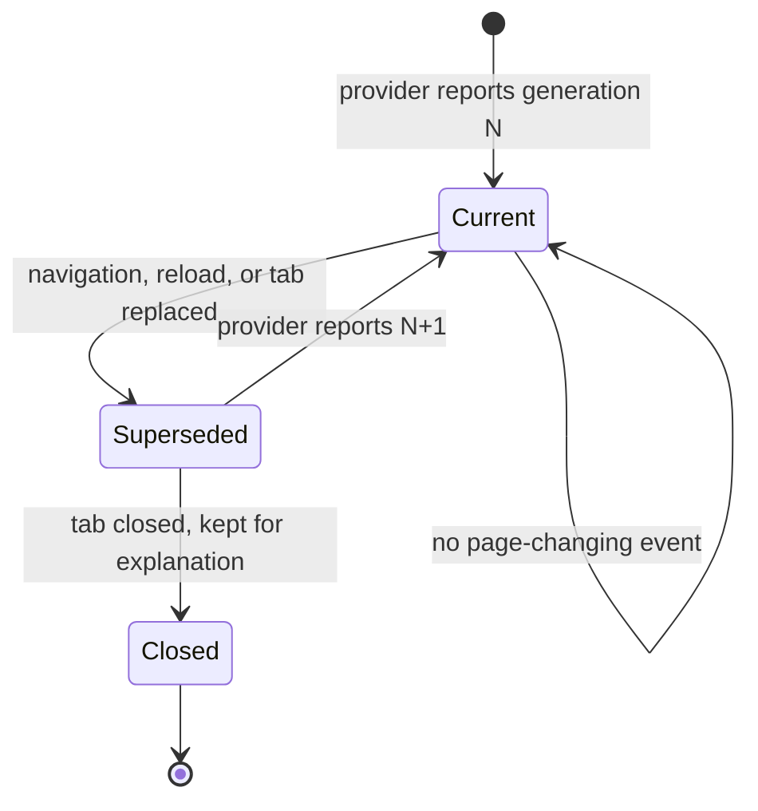

# Target identity, generation and selection

**Status:** This document mixes three kinds of statement, labelled inline:

| Label | Means | Backed by |
| --- | --- | --- |
| `implemented` | The source does this today; the row names the file and line. | `packages/webui/src/runtime/browser/target-registry.ts` |
| `required` | A rule the contracts pin with no enforcing code at that point. | `packages/webui/src/shared/contracts/browser.ts` |
| `not yet measured` | An open question. Not a denial and not a promise. | Nothing |

**The registry exists and its generation is now fed.** `WebuiBrowserTargetRegistry` is implemented in
`packages/webui/src/runtime/browser/target-registry.ts`, `isCurrent` compares the generation
(`target-registry.ts`), and `WebuiBrowserService.#ensureProvider` subscribes to the provider's
`onTargetChanged` and calls `raiseGeneration` (`browser-service.ts:620`), so the counter advances when
the page behind a target is replaced. Finding F2 in
[`07-review-findings.md`](07-review-findings.md) records what this closes and what remains unmeasured.

The panel and the Agent must address the same page. That is only true if both sides name a target the
same way, and if a name recorded against an old page cannot quietly land on the new one. This document
owns that naming.

## The identity

`WebuiBrowserTargetId` is four fields, not one:

| Field | Type | What it distinguishes | Why it is needed |
| --- | --- | --- | --- |
| `surface` | `"isolated-chromium" \| "edge" \| "chrome"` | which browser kind | A target id from Chrome must never be accepted for Edge |
| `browserId` | `string` | which *instance* of that surface | Two Edge windows pairing with the same host, or a relaunched isolated Chromium, both yield tab ids that a browser alone would not distinguish |
| `targetId` | `string` | which tab inside that browser | The tab is what a page lives in |
| `generation` | `number` | which *page* behind that tab | The tab id survives a navigation and a reload, so it alone cannot say the page is the same one |

`isSameWebuiBrowserTarget` compares all four. A mismatch on any one of them is a different target.

The three parts and the generation line up with what can independently go stale: the browser, the tab,
and the page behind the tab.

## Generation

A generation is a monotonic per-target counter. `WEBUI_BROWSER_TARGET_GENERATION_UNSET` is `0`, the
value before a provider has ever reported one.

### What invalidates a generation

| Event | Invalidates | Note |
| --- | --- | --- |
| Navigation to a new document | yes | Including same-document and in-page navigation where the provider can detect it |
| Reload | yes | A reload produces a new document; the tab id is unchanged |
| Target replaced — a tab closed and reopened, or a new tab reused the id | yes | This is the case the `browserId` field alone would not catch |
| Frame replaced or destroyed inside the page | for references bound to that frame | The target itself may stay valid |
| Paint, focus change, scroll, DOM mutation without navigation | no | The page is still the page |
| A *different* tab in the same browser | no for this target | It is a different `targetId` |

The line that matters: **the page behind a tab id changing invalidates the generation; the page's
content changing does not.**

### Why the generation is in the identity

The failure it prevents is a mis-aimed action rather than a failed one. The Agent inspects a page,
receives an element reference, the user clicks something in the panel, the page navigates, and a stale
reference lands on whatever now occupies those coordinates. Nothing in the system would raise an error:
the coordinates were valid and the target existed. Carrying the generation makes the mismatch detectable
before dispatch.

## Rejecting a stale reference

A caller names a target; the host compares the whole identity against the registry and refuses rather
than resolving to the nearest match.

| Situation | Result | Pinned code | State |
| --- | --- | --- | --- |
| Identity matches surface, browser, tab **and** generation | proceed | — | `implemented` — `isCurrent`, `target-registry.ts` |
| Generation is behind the registry's | refuse — the page moved on | `browser_target_stale` | `implemented` — `sendInput` calls `isCurrent` (`browser-service.ts:848`), and the registry's generation is raised from `provider.onTargetChanged` (`browser-service.ts:620`) |
| Surface or browser does not match, or the target is absent | refuse — no such target here | `browser_target_unknown` | `implemented` — `selectTarget`, `browser-service.ts:777` |

**How the registry learns that the page moved.** The provider is the only party that knows when the page
behind a target is replaced, so `#ensureProvider` subscribes to it and forwards the announcement
(`browser-service.ts:620`):

| Counter | Owner | Behaviour |
| --- | --- | --- |
| `WebuiIsolatedChromiumProvider.#generation` | the provider | Starts at 1, increments on a main-frame `Page.frameNavigated`, and is reported in `listTargets` and on every image frame |
| `WebuiBrowserTargetRegistry` entry generation | the registry | Raised through `raiseGeneration` when the provider announces the change |

`observe()` deliberately does **not** raise the generation on a repeat sighting — a provider reports its
target list repeatedly, and raising on every sighting would invalidate every reference the moment the
provider refreshed its list. The registry's counter therefore advances only on a real page replacement,
which is what makes `isCurrent` meaningful.

**`not yet measured`** — no probe or integration run drove a navigation and then observed a refused
input. This check is verified by reading the source, not by watching it fire.

Two rules follow from this and are worth stating separately, because they are where a "helpful"
implementation goes wrong:

- **Never resolve a partial match.** A matching `targetId` under a different `browserId` is a different
  target, not a near miss.
- **Never silently refresh a generation.** If the registry knows the target moved on, a caller holding an
  old generation is told so; the registry does not quietly swap in the new one. Otherwise the caller
  cannot tell that its references died.

A closed target is kept rather than dropped, so that a stale reference is *explainable*
(`WebuiBrowserTargetStatus` is `"open" | "closed"`). Dropping it would turn a diagnosable
`browser_target_stale` into an unexplained `browser_target_unknown`.

### Where this reaches the wire

Every target-bearing message carries the generation, on both sides of the bridge:

| Contract | Field |
| --- | --- |
| `WebuiBrowserImageFrame` | `target: WebuiBrowserTargetId` — generation included, so a client can drop a frame for a page it is no longer showing |
| `WebuiBrowserInputCommand` | `target: WebuiBrowserTargetId` — the command is bound to the page it was aimed at |
| `WebuiBrowserBridgeTarget` | `generation` |
| `WebuiBrowserBridgeImageFrame` | `generation` |
| `WebuiBrowserBridgeInputCommand` | `generation` on every variant |

The bridge projects the four-field identity down to `browserId` + `targetId` + `generation` on the wire,
because the surface and the browser are established by which socket and which allowlisted extension
identity the message arrives on. See [`02-bridge-protocol.md`](02-bridge-protocol.md).

## Selection is scoped to the Agent run / TUN

| Rule | Consequence | State |
| --- | --- | --- |
| Each Agent run / TUN owns its own target selection | Two concurrent runs select independently | `implemented` — the service keys its selections by surface and then by run (`WebuiBrowserService.#selected`) |
| One run's selection must not overwrite another's | Selecting a tab in run A does not move run B's target | `implemented` — the selection map is per run |
| The Agent may choose a different authorized tab each turn | Selection is not pinned for the life of a run | `implemented` — the Agent's `open_tab` is the path: it creates a page and makes it the run's selection (`runtime/browser/tool-adapter.ts:178`, `runtime/browser/browser-service.ts:1188`), so a run's selection is not pinned for the life of the run |
| **After switching tabs, the Agent must reacquire page elements** | References from the previous tab are dead | `implemented` — Browser Core holds the element map and the retained snapshot, and refuses a reference whose page has moved on with a stale-reference refusal (`STALE_ELEMENT_REF`, or `STALE_SNAPSHOT` when the snapshot itself is the stale part). A reference on a page that did **not** navigate stays usable. `packages/browser-core/src/browser-action-targets.ts`; `packages/webui/test/integration/browser-core-agent-actions.test.ts` |
| Operations against the same tab are serialized | One writer per tab | `required` — the service and the CDP connection both answer commands without serializing them per target |
| Operations against different tabs may proceed independently | Concurrency is per tab, not global | `implemented` — each page of the isolated Chromium has its own CDP session (`runtime/browser/isolated-chromium/provider.ts:249`), so a command against one tab does not wait for another |

**Two fences, not one.** The reacquire rule used to be a rule on the caller, because the generation
counter could only report a mismatch — it could not re-resolve an element reference. That is no
longer the case, and the two paths now have their own fences:

| Path | Fence | Code |
| --- | --- | --- |
| A **command** the Agent sends | `STALE_ELEMENT_REF` — the reference is refused when the snapshot it was recorded against no longer matches the live page | `packages/browser-core/src/browser-action-targets.ts` |
| **Input** the person sends | `browser_target_stale` — the command is refused when the target's generation has moved on | `runtime/browser/browser-service.ts:848` |

The command path's fence is the core's, and it is the core's because the core holds the element map
and the retained snapshot that make a reference meaningful. A reference recorded against generation
*N* is still refused at *N+1* — but the refusal is now a mechanism, not a convention, and a caller
that ignores it gets a stale-reference refusal rather than a mis-aimed click.

See [`10-browser-core-integration.md`](10-browser-core-integration.md).

## The panel follows the active run

There is one browser panel. It shows the target of the **active or focused** Agent run, and it shows
that run's target rather than any other run's. This section describes the tree as it stands;
[ADR 0022](../adr/0022-webui-workspace-panel-is-a-browser-tab-strip.md) replaces the single panel
with a per-session tab strip and separates the run's selection from the tab a person is looking at.
The rules that decision pins are in [The tab model](#the-tab-model-adr-0022).

| Rule | Reason | State |
| --- | --- | --- |
| The panel reports the active run's selection | The person can see which page the Agent is working on, and it is a different page from the one in front | `implemented` — the panel reads the run's selection from the target list (`BrowserPanelHost` → `listBrowserTargets`) and mirrors it into `WebuiBrowserPanelState.runSelection`; the **toolbar** names that page at the quiet end of the row (`webuiBrowserAgentPage`). It **reports** rather than projects: the panel shows the page in front (below) |
| Changing runs updates what the panel reports | The panel re-reads the newly active run's selection, and the page in front does not move with it | `implemented` — the panel re-reads the list when the run changes; `run-changed` clears `runSelection` and leaves `viewedPage` alone |
| A frame for a target the panel is not showing is dropped | The frame carries its identity, so a stale or out-of-band frame is detectable and is not displayed as if it were the chosen page. | `implemented` — `WebuiBrowserService.#frameMatchesTarget` (`browser-service.ts:1098`) compares all four identity fields and the stream drops non-matching frames (`browser-service.ts:944`); see finding F6 |
| The panel never writes the run's selection | Selection belongs to the Agent; the panel reflects it | `implemented` — the mark in the toolbar is a report of the runtime's mark, with no write behind it: `BrowserPanelProps` has no `onSelectTarget` and nothing in the panel calls `selectBrowserTarget`. The person writes the cell they own — the tab in front — by choosing a tab in the strip |

That last row is the distinction that keeps the panel honest. The run's selection is the Agent's cell,
and a person cannot move it from the panel at all: a click that used to hand the Agent a page is gone,
because the strip — which the ADR 0022 gives the row of tabs — is what the person writes now. If the
panel could move a selection on its own, it would be a second writer on the same per-run selection, and
the run's choice would stop being authoritative.

The frame's `sequence` is a monotonic per-stream counter, so a client can also detect a dropped frame —
a liveness signal that is independent of whether the frame was the right one.

## The tab model (ADR 0022)

[ADR 0022](../adr/0022-webui-workspace-panel-is-a-browser-tab-strip.md) replaces the single browser
panel with a per-session browser tab strip. It is in the tree: every rule below is `implemented`, and
the row says what carries it. The rules that are *not* the tab model's — a caller obligation, or a
concurrency rule the tree does not enforce — are still `required`, and they say so.

| Rule | Consequence | State |
| --- | --- | --- |
| A tab is a slot whose content can be replaced in place | Choosing a launcher tile or typing a URL changes what the tab shows; the tab is not closed and the strip does not flicker | `implemented` — `replaceTabContent` (`client/features/workspace/projection/workspace-panel-state.ts:422`) replaces the content of the tab that is open, and the strip's own launcher does it (`client/features/workspace/ui/WebuiWorkspaceTabStrip.public.tsx:428`) |
| The tab's id belongs to the client | Two web tabs in one session are two tabs, and the id does not change when the content does; the target identity is a binding the tab holds | `implemented` — `openNewTab` assigns the id from the client's own counter (`client/features/workspace/projection/workspace-panel-state.ts:355`, `:258`), and the content carries the binding (`WorkspacePanelTab`, `client/features/workspace/projection/workspace-panel-state.ts:120`) |
| The URL box belongs to the new tab page | There is no persistent address bar; a web tab carries a toolbar (back, forward, reload, read-only URL) instead | `implemented` — the only field for a URL is the launcher's (`WebuiWorkspaceLauncher`, `client/features/workspace/ui/WebuiWorkspaceTabStrip.public.tsx:428`); a web tab's URL is a `span`, not an input (`client/features/browser/ui/BrowserPanelHost.public.tsx:547`) |
| A web tab holds exactly one browser page | The isolated Chromium holds one page per web tab, so a page is addressable by the tab that shows it | `implemented` — the provider's per-target map holds one page per web tab (`runtime/browser/isolated-chromium/provider.ts:249`), and the command path resolves the session by target |
| A web tab is titled by the page and glyphed by default | The title is the one the provider already reports; the icon is a default glyph, and fetching a site's icon is not part of this | `implemented` — the title is the one the runtime's snapshot publishes, and the strip renders it with a default glyph (`client/features/workspace/ui/WebuiWorkspaceTabStrip.public.tsx:217`); no icon is fetched |
| The Agent opens web tabs | `open_tab` creates a page, makes it the run's selection and tells the client, so a tab appears in the strip and becomes the active one | `implemented` — the tool adapter lets `open_tab` through for a run with no selection (`runtime/browser/tool-adapter.ts:178`), the service opens the page and makes it the run's selection (`runtime/browser/browser-service.ts:1188`), and the strip turns the published tab into a panel tab (`client/features/workspace/ui/WebuiWorkspaceTabStrip.public.tsx:140`) |
| The run's selection and the person's active tab are separate cells | A person opening their own tab does not move the Agent off its page, and the Agent opening a tab does not yank the person away from theirs. The person's input follows their tab; the Agent's actions follow the run's selection | `implemented` — `WebuiBrowserPanelState.viewedPage` (the client's cell, written by `page-viewed`) and `runSelection` (the runtime's cell, written by `targets-loaded`). The picture, the alt text, the frame stream and the input binding all read `viewedPage`; `prepareWebuiBrowserInputCommand` takes it as its own argument, so no gesture can be aimed at the run's page |
| One bootstrap: a person opening a web tab gives the run that page **only when the run has no selection** | A run with no selection cannot act at all, so the person's page becomes the run's selection; after that the two cells are independent | `implemented` — `openWebTab` takes a `WebuiBrowserTabOpener` (`"agent"` or `"person"`), and a person-opened page joins the run's selection only when `#selectionOf(surface, runId)` was undefined at the moment the page appeared. The runtime decides it, because the runtime is the only place that can read that selection; the workspace names its session and applies nothing itself |
| Closing a web tab closes its page | The runtime's page set follows the strip, so a closed tab leaves no page behind in the Chromium | `implemented` — `closeWebTab` closes the page and forgets the target (`runtime/browser/browser-service.ts:421`) |
| The browser tool tab is deleted | The strip's kinds lose `browser` and with it the surface switcher: the panel is the isolated browser's view, and the external browsers are driven in the user's own windows | `implemented` — the registry has no `browser` kind (`client/features/workspace/projection/workspace-panel-state.ts:29`), and the published host is keyed by the web tab's target rather than by a switchable surface (`client/features/browser/ui/BrowserPanelHost.public.tsx`) |
| Frames are per target | Each tab's picture is its own; a frame reaches only the tab that asked for it | `implemented` — the stream is keyed by the target (`runtime/browser/browser-service.ts`), and the provider routes a frame to its page by the envelope's session id (`runtime/browser/isolated-chromium/provider.ts`) |

The last two rows are the ones that change the previous section. The panel is no longer a projection
of the run's selection: it shows the tab the person is looking at, and the run's selection is a
separate cell with a separate writer. Both are named in the code as they are named here —
`WebuiBrowserRunSelectionTarget` and `WebuiBrowserViewedPage` in
`client/features/browser/contracts/browser-panel.ts` — and both were observed on a real isolated
Chromium in `packages/webui/test/integration/isolated-chromium-two-pages.test.ts`, "the run's selection
and the tab in front, on a real browser": the Agent drove one page while the person typed in another,
each page ended up holding only its own input, and an input recorded before a page moved was refused
with `browser_target_stale` rather than dropped.

## Related

| Concern | Document |
| --- | --- |
| The identity and generation as wire shapes | [`02-bridge-protocol.md`](02-bridge-protocol.md) |
| Which switch must be on before any of this runs | [`06-runtime-authorization-trace.md`](06-runtime-authorization-trace.md) |